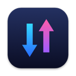
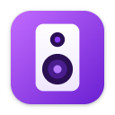

# Oi, eu sou o Marcos 

Moro no Rio de Janeiro e faço apps para o Mac que eu mesmo uso no dia a dia. Quase tudo em
**Swift e SwiftUI**.

## Projetos

<table>
  <tr>
    <td width="96" align="center"></td>
    <td><a href="https://github.com/marcosznl/fluxo"><b>Fluxo</b></a> Teste de velocidade da internet e tráfego ao vivo na barra de menus do macOS.</td>
  </tr>
  <tr>
    <td width="96" align="center"></td>
    <td><a href="https://github.com/marcosznl/tocando"><b>Tocando</b></a> A música que está tocando no Mac aparece no seu status "Ouvindo" do Discord.</td>
  </tr>
  <tr>
    <td width="96" align="center"></td>
    <td><a href="https://github.com/marcosznl/som-na-caixa"><b>Som na Caixa</b></a> Salas de música para ouvir junto no navegador: fila de DJs, YouTube sincronizado e chat. <a href="https://som-na-caixa.onrender.com">Abrir o site</a>.</td>
  </tr>
  <tr>
    <td width="96" align="center"></td>
    <td><a href="https://github.com/marcosznl/bot_discord"><b>Arco</b></a> Bot de Discord em Python com moderação, comunidade, música e níveis. Projeto concluído.</td>
  </tr>
</table>

Tem mais coisa por aqui que fica privada: um player de vídeo, um app de downloads e um chat com
voz e música para a galera.
